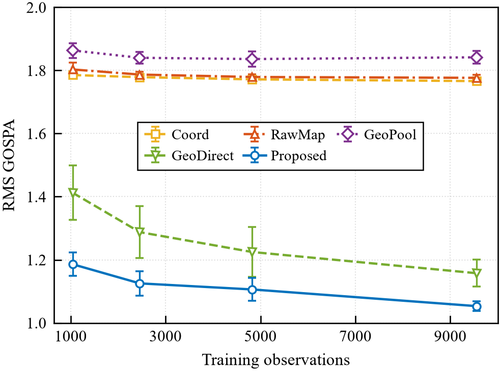
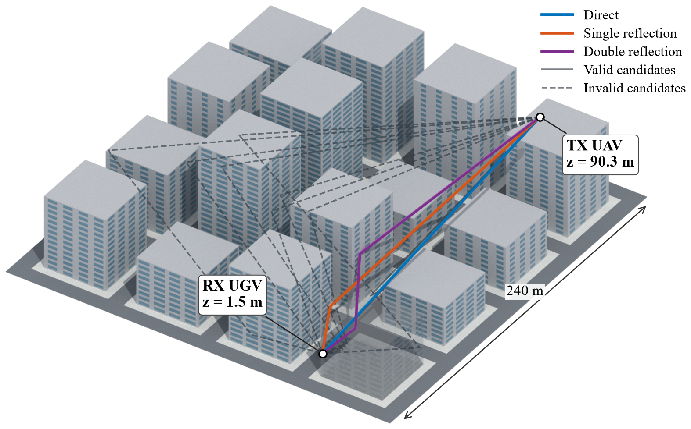

# Air–Ground Channel Modeling — Source Code and Simulation Results

Geometry-informed learning for multipath 6D channel knowledge map (CKM) reconstruction from sparse, noisy air–ground path-set observations. The October 30, 2026 update includes the revised sounding protocol and complete learning curves for five methods at four observation budgets: **200 three-member ensembles (600 model members)**.

## Contents

- `ckm_sim/`: propagation, sounding, parameter estimation, and GOSPA metrics
- `support/`: geometric candidates, physical utilities, and candidate-level learning
- `scripts/`: training, evaluation, diagnostics, and current plotting entrypoints
- `configs/`: experiment settings, frozen hyperparameters, and sensitivity configurations
- `extensions/full_learning_curves_20261030/`: additional 60 ensembles and merged 200-ensemble tables
- `results/`: original 140-ensemble statistics, full-budget comparisons, and supplementary diagnostics
- `figures/`: current simulation scene and five-method learning curves (PDF/PNG)
- `tests/`: implementation tests
- [Reproduction guide](docs/REPRODUCING.md): setup, verification, plotting, and simulation workflow
- [Complete result guide](results/README.md): table definitions and supplementary findings

## Main results

All methods use ten paired noise/optimization streams and the same 4,096 test queries. Values are mean ± sample standard deviation of RMS GOSPA at the full training budget.

| Method | RMS GOSPA |
|---|---:|
| Coord | 1.766 ± 0.007 |
| RawMap | 1.777 ± 0.009 |
| GeoPool | 1.842 ± 0.021 |
| GeoDirect | 1.158 ± 0.043 |
| **Proposed** | **1.053 ± 0.015** |

Proposed reduces RMS GOSPA by **40.72%** relative to RawMap and **8.92%** relative to GeoDirect, averaged over paired streams. With approximately 2,457 observations (25.7% of the full 9,556 records), Proposed achieves 1.125, below GeoDirect's full-budget 1.158. Proposed remains better than both comparators under all 15 tested normalization configurations.





The frozen code identifier `Full` denotes **Proposed**. It is retained in configurations and CSV keys to preserve correspondence with the experiment.

## Setup and quick verification

For table checks and learning-curve plotting only:

```bash
python -m pip install numpy scipy matplotlib
python scripts/verify_public_results.py
python scripts/plot_learning_curves.py
```

Plotting requires an installed **Times New Roman** font and uses MATLAB-style colors, boxed axes, and inward ticks. Error bars show sample SD across ten paired streams.

For the simulation environment, use Python 3.12 and install the executed package versions in `requirements.txt`. See the reproduction guide for data dependencies and GPU scheduling.

## Availability

This repository distributes simulation source, configurations, aggregate/per-stream result tables, and figures. **Raw and processed datasets, scene meshes, batch arrays, trained checkpoints, and per-query predictions are not distributed in this update.** Table verification and learning-curve plotting work with this checkout alone; end-to-end simulation replay and scene rendering require those external inputs. Manuscript drafts and private project links are excluded.
